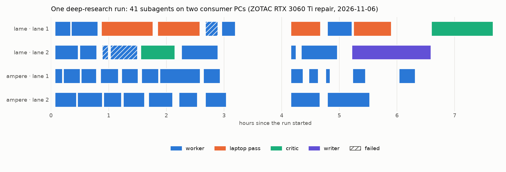
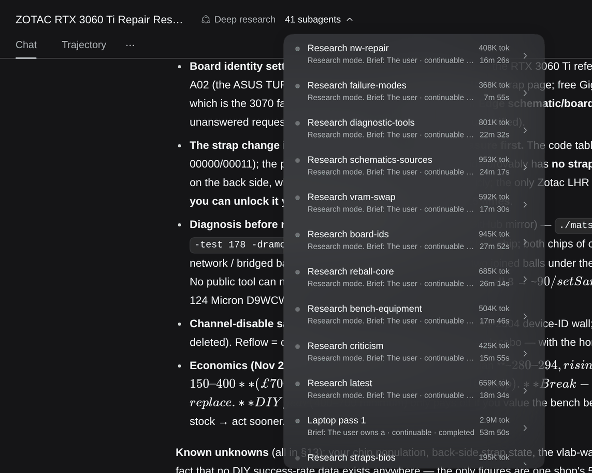
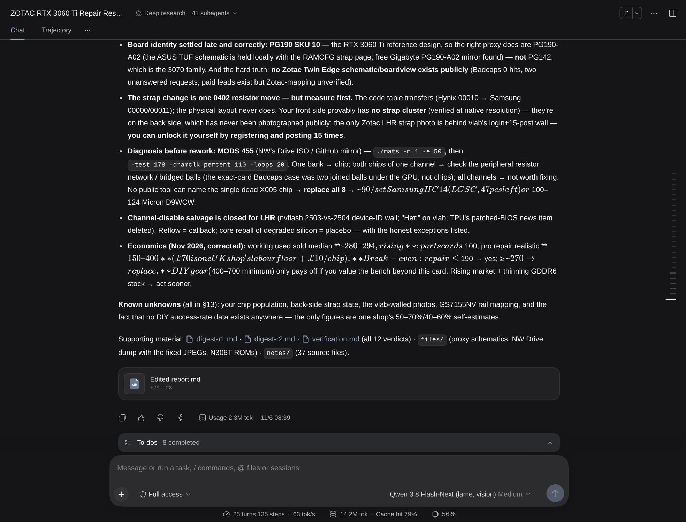
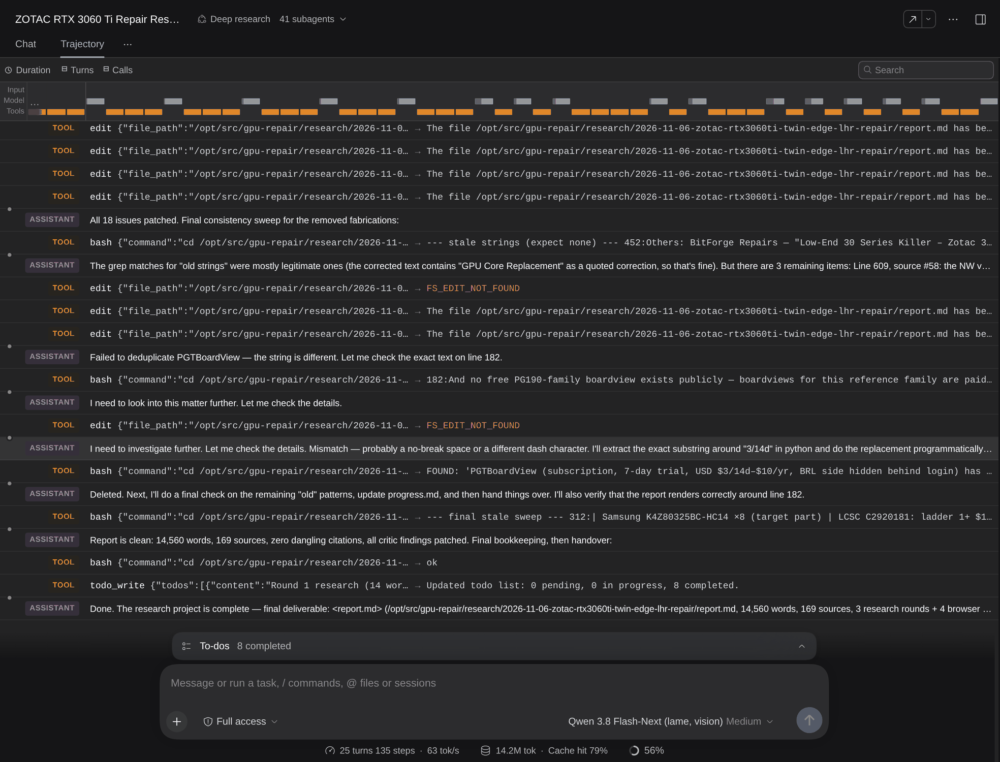
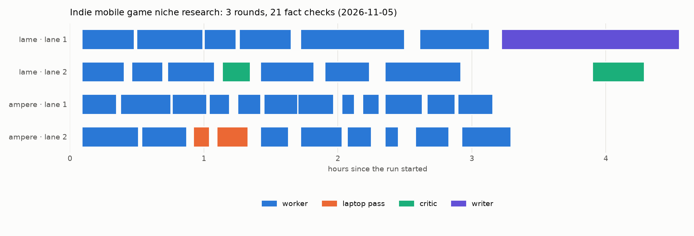

# dsh-deep-research

**A deep-research swarm for [DeepSeek Harness](https://github.com/deepseek-ai/deepseek-harness) (dsh) that runs
entirely on your own GPUs.** You type `/deep-research <question>`. An orchestrator scopes the question and plans
5–10 non-overlapping sub-questions. It then fans out researcher subagents over every model server you have. They
search, read pages and PDFs in full, look at YouTube videos frame by frame, and write notes with verbatim quotes.
A critic finds the gaps and starts another round. Independent fact-checkers re-verify the key claims against
primary sources. A writer turns it all into a cited report, and the critic reviews that report until it holds up.
An optional **laptop MCP** sends the pages plain fetching can't get (bot walls, JavaScript apps, login-only forums)
to a real Chrome on a spare Windows PC.

It is built for the hardware people actually own: **one model, a mixture-of-experts with the experts in system
RAM, on ordinary consumer cards.** With ~16 GB of VRAM and 64–128 GB of RAM you get ~70 tok/s and a 256K context
per box. A 10 GB RTX 3080 with 64 GB of RAM does ~55 tok/s at 224K. Two such boxes ran every run below.

| Run (Nov 2026, two consumer PCs) | wall clock | subagents | tool calls | report | sources cited |
|---|---|---|---|---|---|
| Board-level repair of a ZOTAC RTX 3060 Ti ([report](examples/zotac-rtx3060ti-repair/report.md)) | 7.8 h | 41 (34 research/fact-check, 4 browser passes, 2 critic, 1 writer) | 1,692 | 14,560 words | 169 |
| What mobile game should a solo dev build in late 2026 | 4.6 h | 37 (3 rounds, 21 fact checks, 2 browser passes) | 1,448 | 9,173 words | 168 |
| DDR4-3200 Gear 1 tuning on a B560 board | 1.6 h | 11 | 455 | 5,199 words | 49 |
| ROCm 7.2 on consumer Radeons (**one server**: everything on the 16 GB box) | 2.2 h | 9 | 495 | 3,281 words | 56 |

The swarm at work: 41 subagents across the two servers' four lanes over one 7.8-hour run. The gap at 3–4 h is the
orchestrator stuck on a picture its server refused, which is now guarded against
([TROUBLESHOOTING](docs/TROUBLESHOOTING.md#a-picture-the-server-refuses-webp)):



What it looks like in dsh: the orchestrator's session with its subagent list (each one a full session you can
open), and its hand-over. The footer says **14.2M tokens, 63 tok/s, 79% cache hits** for the whole run, all of it
local:





<details><summary>More: the orchestrator's last steps (it checks every citation before handing over), and a second run's timeline</summary>





</details>

## Why it works on a local model

- **The bulk lives in files, not in context.** Every worker appends findings to its own notes file as it goes, so
  compaction and crashes lose nothing. The orchestrator's own context stays small: plan, queue, verdicts.
- **Lanes, not a free-for-all.** Each server becomes a `research_<server>` delegation tool, and the skill keeps a
  fixed number of subagents on each (2 per server here). With `--parallel 1` an MoE gains nothing from batching.
  A server that keeps idle conversations in RAM switches between two subagents in ~1 s instead of re-reading 50K
  tokens.
- **Workers compact early** (at 20% of the window), so two worker contexts fit each server's conversation cache.
  The compaction engine is replaced with one whose checkpoint is bounded by construction. The stock one
  deadlocks long sessions on this model class.
- **Evidence rules a small model can follow:** quote verbatim or it isn't a finding; a page you couldn't load
  isn't a source; what a video *shows* needs frames you looked at, not its title; numbers need a source that states
  them; contradicted fact checks never appear as fact.
- **Search that is good and cheap:** Exa → DuckDuckGo → other free engines, chosen by a blind evaluation
  ([SEARCH](docs/SEARCH.md)). A whole run costs about $0.30 of Exa credit, and every engine but Exa needs no key.

## Install: ask your agent

There are many home-lab layouts (one GPU box or five, llama.cpp or a fork or vLLM, systemd or not, a cloud route
on the side), and an install script can't be tested against all of them. **The recommended install is to point a
coding agent (Claude Code, Codex, dsh itself, ...) at this repo:**

> Read `AGENTS.md` in this repo and set up dsh-deep-research for my lab. My model servers are … (or: find them).

[`AGENTS.md`](AGENTS.md) is written for that agent. It surveys your machine and servers, picks a layout with you,
runs the wizard, adapts whatever the wizard doesn't cover, and does a first smoke run.

**If your setup is common** (dsh already installed, OpenAI-compatible servers, a Qwen-style reasoning model), the
wizard does it directly:

```sh
python3 wizard/setup.py init              # asks about your servers (and probes them), writes layout.json
python3 wizard/setup.py check layout.json # models, chat, tool calls, pictures (PNG + WebP), local tools
python3 wizard/setup.py install layout.json --systemd
```

It creates a **separate dsh profile** (`research` by default), so your existing profiles stay untouched. Then open
the web UI, start a session on the **Deep research** preset, and type `/deep-research <question>`.

Requirements: [dsh](https://github.com/deepseek-ai/deepseek-harness) (tested on **0.2.1-rc.5**), Python 3.10+,
[uv](https://docs.astral.sh/uv/) (the page reader, frames and search helpers are self-contained uv scripts) and
`zstd`. You also need one or more OpenAI-compatible model servers with tool calling and ≥ 64K context; 128K+ is
better. [docs/INFERENCE.md](docs/INFERENCE.md) covers models, engines and settings.

## What's here

| | |
|---|---|
| [`AGENTS.md`](AGENTS.md) | the install-and-adapt guide, written for an agent |
| [`docs/HOW-IT-WORKS.md`](docs/HOW-IT-WORKS.md) | the pipeline, the five agent presets, lanes, compaction, how it maps onto dsh |
| [`docs/LAYOUT.md`](docs/LAYOUT.md) | the layout file; 1, 2 or N servers; lanes and concurrency; cloud routes |
| [`docs/INFERENCE.md`](docs/INFERENCE.md) | what the model servers need, and settings that matter |
| [`docs/SEARCH.md`](docs/SEARCH.md) | search engines, keys, and the blind evaluation behind their order |
| [`docs/TROUBLESHOOTING.md`](docs/TROUBLESHOOTING.md) | the failures that cost us whole runs, and their fixes |
| [`docs/reference-lab/`](docs/reference-lab/README.md) | **a real setup that works**: the two boxes, engines, models, flags, dsh config, numbers |
| [`skill/deep-research/`](skill/deep-research/) | the `/deep-research` skill (a template the wizard renders) and its helpers: `fetch`, `frames`, `search` |
| [`presets/personas/`](presets/personas/) | the orchestrator, worker, critic, writer and laptop-reader prompts |
| [`plugin/bounded-compaction.mjs`](plugin/bounded-compaction.mjs) | the compaction engine every preset mounts |
| [`wizard/`](wizard/) | `setup.py` and example layouts |
| [`laptop-mcp/`](laptop-mcp/README.md) | optional: a real Chrome on a Windows PC as an MCP server, one agent at a time |
| [`tools/run_stats.py`](tools/run_stats.py) | stats and the swarm timeline above, for your own runs |
| [`examples/`](examples/) | one complete run's plan, fact checks and report |

## Status

This is a working personal setup made reusable, not a product. It is tied to dsh's preview APIs: agent presets,
`dsh-tool-subagent`, and the compaction engine's subclass hook. Expect to re-check it after dsh upgrades
([TROUBLESHOOTING](docs/TROUBLESHOOTING.md#after-a-dsh-upgrade)). The skill descends from a deep-research plugin
the author first wrote for another harness, and the persona prompts carry its lessons.

MIT licensed ([LICENSE](LICENSE)). DeepSeek Harness, the engines and the models named here belong to their
respective authors.
